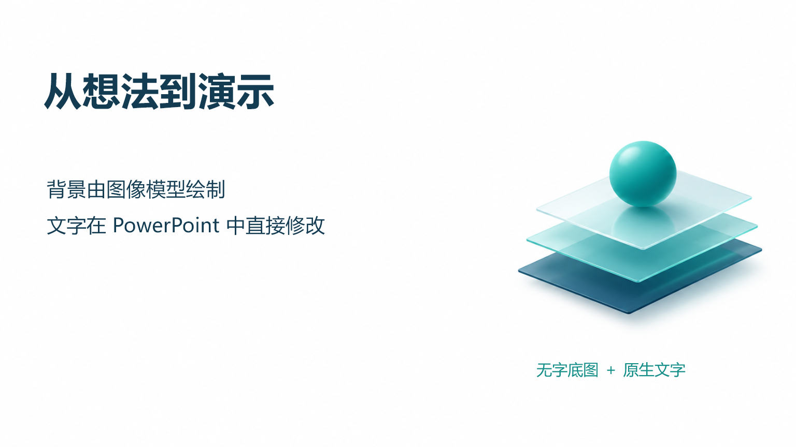

# BitQin1111 · Codex PPT Editable

基于 [ningzimu/codex-ppt-skill](https://github.com/ningzimu/codex-ppt-skill) 的独立增强技能。
**先问模板 → 无模板时选风格 → 再问素材 → 生成无字背景/配图 → 插入原生可编辑文字 → 交付 PPTX。**

这不是整页截图式 PPT，也不是用代码绘制底图。新绘制的背景、示意图、装饰图标使用 codex-ppt 的图片生成流程；Python 负责文字、用户原图、表格、备注的排版和检查。生成图片可以合并非文字视觉内容，所有新增文字保留为 PowerPoint 对象。



[查看三页示例](examples/minimal/demonstration.pptx) · [检查记录](examples/minimal/validation.md)

## 安装

只安装本仓库内的 `skills/codex-ppt-editable`，**不需要安装原 codex-ppt**。

在 Codex 中使用内置 skill-installer，提供：
- 仓库：`1nnnnnn9/BitQin1111`
- 路径：`skills/codex-ppt-editable`

也可以下载仓库，把该目录放到自己的 skills 目录，保持目录名为 `codex-ppt-editable`。使用项目级技能时按宿主支持的项目 skills 路径安装即可。不要把本 README 所在的仓库根目录误当作技能目录。

首次使用：
> 使用 $codex-ppt-editable 为我制作一份可编辑 PPT。

正常自动发现保持启用；也可通过上述名称显式调用。

## 使用流程

1. 首先确认有无 PPT 模板。已有附件或答案时直接采用，不反复询问。
2. 有模板：先查看代表性页面，提取配色、字体、视觉语言；默认只参考风格，重新组织版式。没有模板：从内置 12 种 codex-ppt 风格中推荐 2–3 种供选择。
3. 接着确认素材，包括图片、图标、图表、表格数据和文字。建立使用清单，尽可能采用相关素材，未用素材说明原因。
4. 确认大纲与素材安排，先制作一页完整的可编辑样页及预览。
5. 样页获批后完成全稿、逐页检查与备注。

用户原始图表不会交给模型重绘；原图内部的坐标、比例尺和已有标注仍属于图片。新增标题、正文、标签、数字结论与参考文献可直接修改。可读表格数据支持原生表格。不能把“可编辑”解释为原始图片中每个像素或标注均可单独编辑。

## 依赖与运行

- Python 3.10+。
- 内置图片生成能力优先；API/CLI 是用户明确选择的备用路径。
- 核心组装依赖：python-pptx、Pillow、filelock。
- 可选预览：宿主自带渲染工具；或 LibreOffice + Poppler。Windows PowerPoint 可人工导出预览。
- API 备用依赖和模型配置见技能中的参考文档。密钥从环境或本地运行时配置读取，不放进仓库。

```sh
python skills/codex-ppt-editable/scripts/runtime.py doctor
python skills/codex-ppt-editable/scripts/runtime.py bootstrap
```

运行时缓存可用 `CODEX_PPT_EDITABLE_HOME` 指定。开发项目、缓存和输出路径由使用者配置，不绑定某一台机器。

## 独立使用示例与检查

`examples/minimal/deck_spec.json` 是三页原生对象组装示例；图片通过生成流程取得后再填入对应路径。具体命令见 [示例说明](examples/minimal/README.md)。

```sh
python -m unittest discover -s tests -v
```

离线测试使用明确标识的测试夹具，不会冒充图片模型生成结果；正式使用必须保留真实的生成来源记录。

## 来源与许可

上游固定版本及改动范围见 [THIRD_PARTY_NOTICES.md](THIRD_PARTY_NOTICES.md)。保留原作者 MIT 声明；新增部分同样按 MIT 发布。此项目为社区衍生增强版，不代表上游作者或 OpenAI 官方。用户提供的模板、字体、品牌和图片的权利不因代码采用 MIT 而改变。
